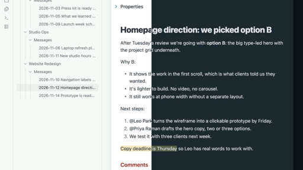

# Trailside

A calm, flat theme for Obsidian, in light and dark, inspired by Basecamp's style.

- Pale mint around the edges, white pages, blue-grey text instead of black.
- Each note sits on a page that floats over the background, with a soft shadow. On phones, notes
  fill the screen as usual.
- Heavy, tight note titles. Section headings (`##`) in brick red, or pale peach in dark mode.
- Flat cards and callouts with 8px corners and a hairline border.
- Pill-shaped tags on a warm cream background.
- Property names in a warm gold-brown, or soft blue-grey in dark mode.
- Green checkboxes with slightly rounded corners. Done to-dos turn grey but aren't crossed out.
- Matching styles for Bases tables, cards and kanban boards.

Trailside uses your system font. It doesn't change your font size, so the size slider in Settings → Appearance still works.

Pairs well with [Bulletin](https://github.com/schooltwistchris/obsidian-bulletin), which pulls Basecamp message boards into your vault. In Bulletin's notes, Trailside shows the title once and lays comments out as a thread, each one under a thin line.

Trailside isn't made by or affiliated with 37signals or Basecamp.

## Install

In Obsidian, open Settings → Appearance, choose Manage next to Themes, and search for Trailside.

To install it by hand instead:

1. Copy `manifest.json` and `theme.css` into `<your vault>/.obsidian/themes/Trailside/`.
2. In Obsidian, open Settings → Appearance and choose Trailside under Themes.

Needs Obsidian 1.9 or newer.

## License

[MIT](LICENSE)
